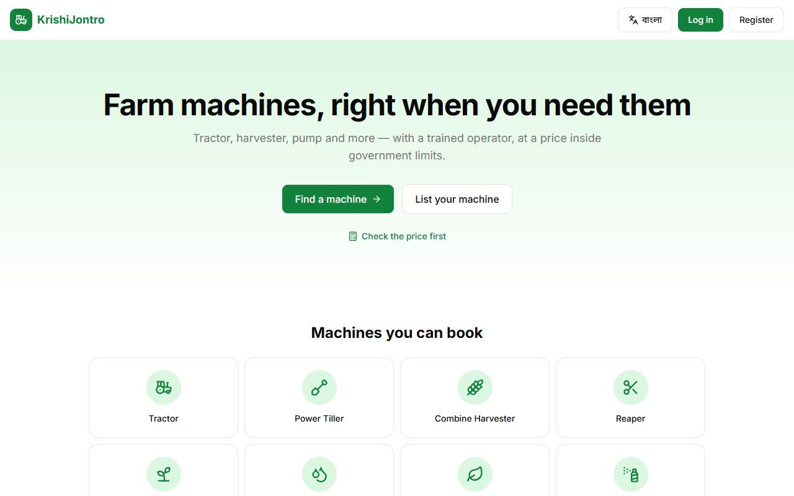
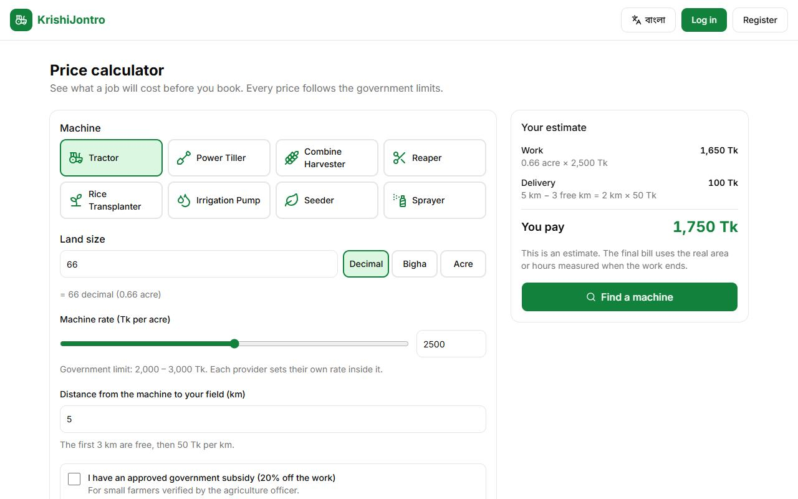
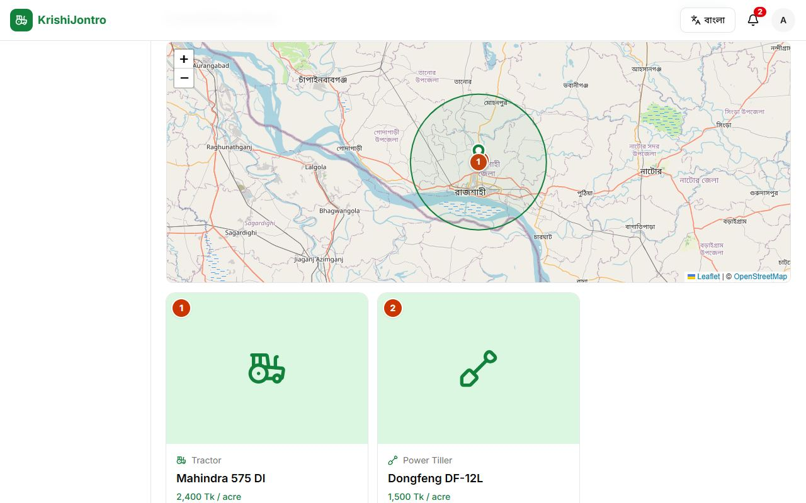
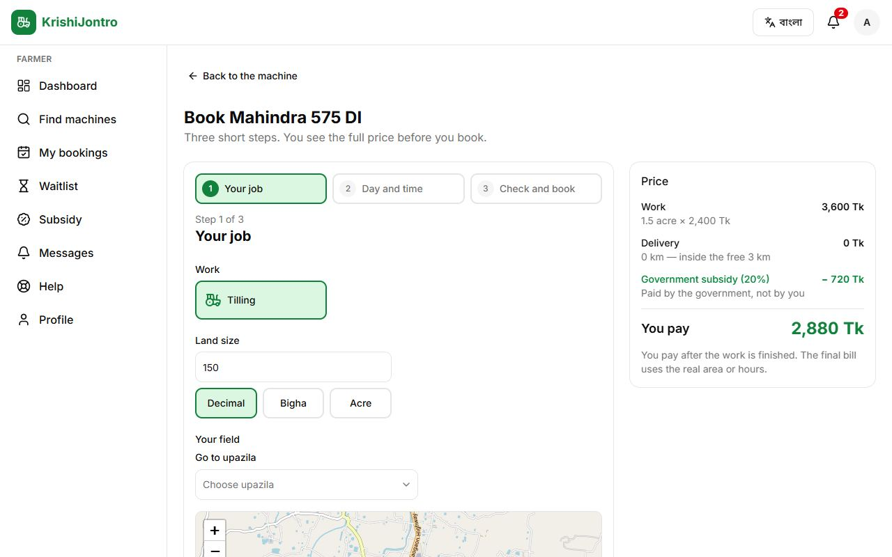
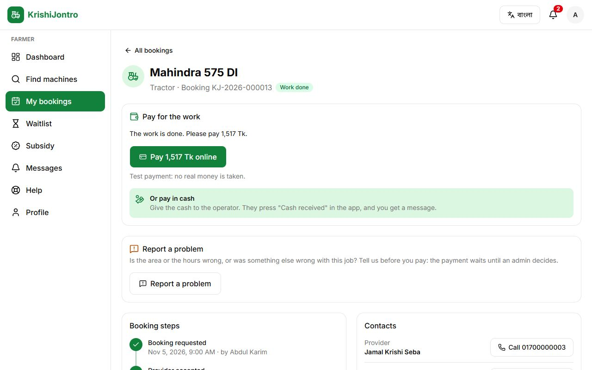
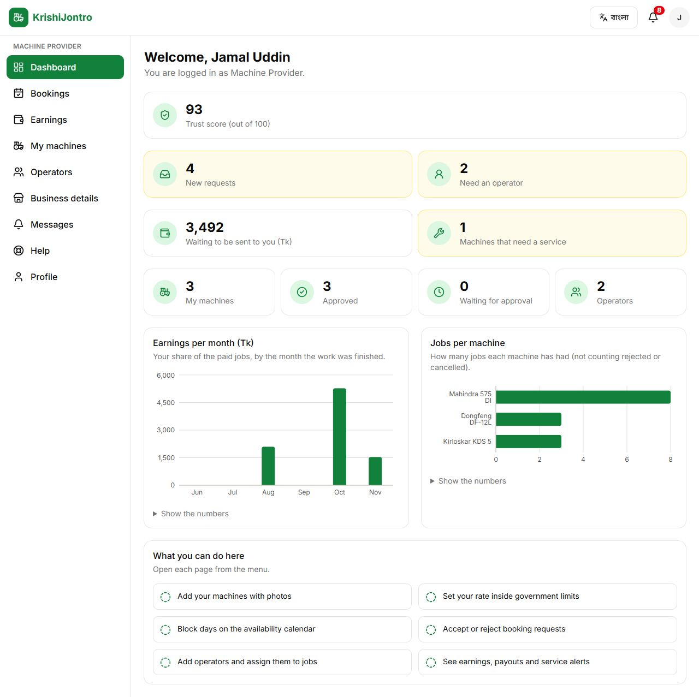
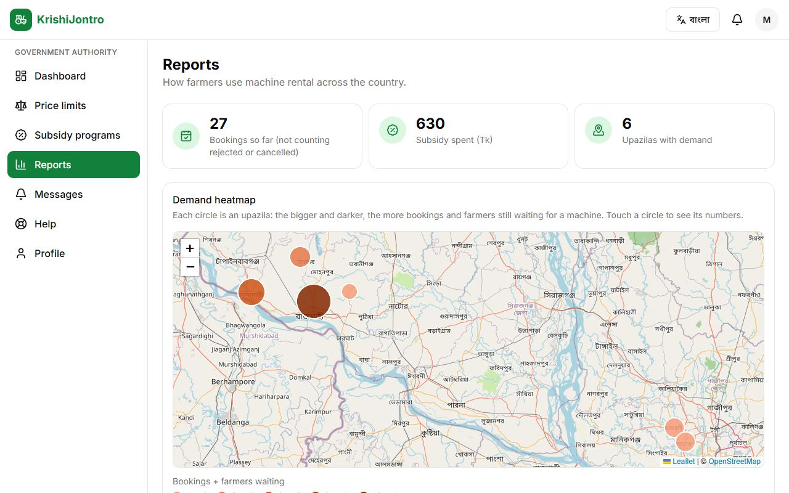
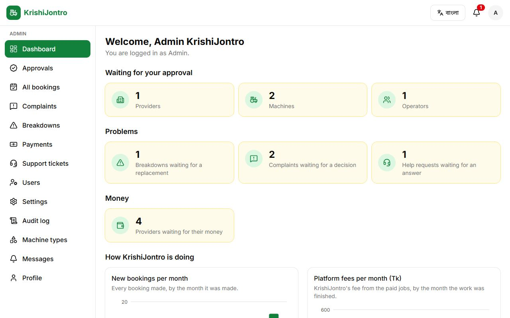
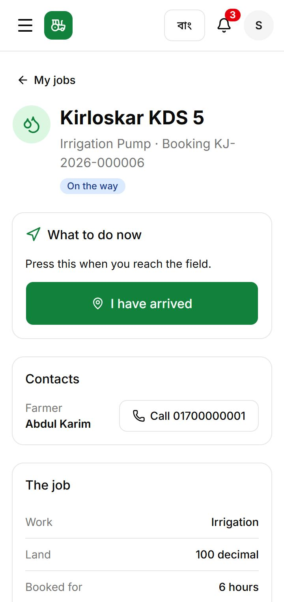
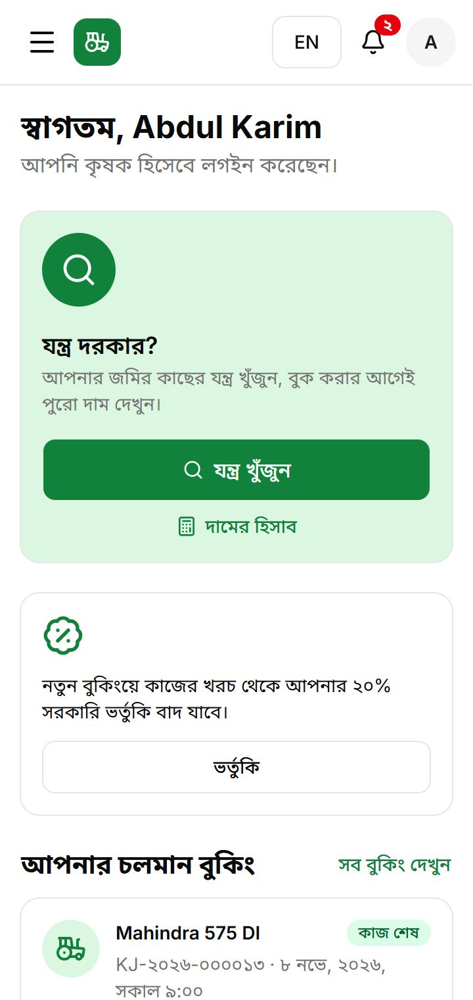

# KrishiJontro (কৃষিযন্ত্র)

KrishiJontro is a web platform where farmers in Bangladesh book agricultural machines
(tractor, power tiller, combine harvester, reaper, rice transplanter, irrigation pump, seeder, sprayer)
together with a trained operator, at a fair price that stays inside government limits.
It works in **English and Bangla** (with Bangla digits) and is made for small phone screens first.

It is built for the course **CSE 3200 – Software Development Project II**.
See [PROGRESS.md](PROGRESS.md) for what was built in each phase.

## Screenshots

| | |
| --- | --- |
|  Home page |  Public price calculator |
|  Farmer: search with map and prices |  Farmer: 3-step booking form with live price |
|  Farmer: a finished booking, ready to pay |  Provider: dashboard with charts |
|  Government: reports and demand heatmap |  Admin: dashboard |
|  Operator: the job screen on a phone |  Farmer: dashboard in Bangla on a phone |

## Who uses it, and what they can do

| Role | What they do |
| --- | --- |
| **Farmer** | Search machines on a map (by work, machine, day, distance), get a machine suggestion from the land size, see the full price before booking, book in 3 steps, follow the booking, give the secret start / finish codes to the operator, pay online or in cash, download a PDF receipt, review the machine and the operator, report a problem, apply for a subsidy, join the waitlist, ask for help |
| **Cooperative leader** | Create a cooperative, add or remove member farmers, book one machine for many members' plots in one village (one trip, delivery shared equally), see the group's history |
| **Machine provider** | Add machines with photos, set a rate inside the government limit, block days on a calendar, accept or reject requests, add operators and send them to jobs, send a replacement machine after another machine breaks down, see earnings and payouts, get service alerts |
| **Operator** | See today's jobs with the farmer's phone and the field on a map; On the way → Arrived → Start (farmer's start code) → Finish (real work done + finish code); report a breakdown with a photo; take cash |
| **Technician** | Take repair and service requests, move them Received → Inspecting → Repairing → Fixed with parts and costs, see each machine's service history |
| **Agriculture officer** | Verify farmers (NID and land) of their upazila, approve or reject subsidy applications, see the bookings and complaints of their upazila |
| **Government authority** | Set price limits per machine type (with a harvest-season cap), run subsidy programs, see reports (bookings by district, demand vs supply, prices, subsidy spent) and a demand heatmap |
| **Admin** | Approve providers, machines and operators; manage users and staff accounts; decide complaints (correct the bill, give money back, fine the provider); answer support tickets; give refunds and send payouts; change platform settings; read the audit log |

Everyone can register (farmers and providers on their own; staff accounts are made by the admin), log in,
change the language, and read their messages. SMS is simulated: messages are saved and shown under **Messages**.

## The main rules (and where they live in the code)

- **Price** (`src/lib/services/pricing.ts`): work = max(quantity, minimum) × rate; delivery = (km − free km) × rate per km;
  subsidy = a % of the work; the farmer pays work + delivery − subsidy; the platform keeps a fee (3 %) from the provider's share.
  Example: 66 decimal at 2,400 Tk/acre, 8 km → the farmer pays **1,517 Tk**, the provider gets **1,779 Tk**.
- **No double booking** (`src/lib/services/booking.ts`): the machine's row is locked inside a database transaction,
  then any overlapping booking or blocked time is refused.
- **One door for every status change**: `changeBookingStatus()` only allows the listed moves and writes the history.
- **Start and finish codes**: 4 digits, only the farmer sees them; 5 wrong tries lock a code until the farmer makes a new one.
- **Breakdown** (`src/lib/services/replacement.ts`): the nearest free machine of the same type within 15 km is offered the rest of the work;
  the farmer never pays more than without a breakdown.

## Tech stack

Next.js 16 (App Router) + TypeScript, Tailwind CSS + shadcn/ui, lucide-react icons, PostgreSQL (Neon) + Prisma,
Auth.js (phone + password, bcrypt), next-intl (English / বাংলা), Zod + React Hook Form, Leaflet + OpenStreetMap
(maps and the heatmap, no API key), Recharts (charts), SSLCommerz sandbox and a test gateway (online payment),
@react-pdf/renderer (receipts), Vercel Blob (photos on Vercel), Vitest (unit tests), Playwright (browser tests).

## Folders

```
src/app/[locale]/(public)/...   home, login, register, price calculator
src/app/[locale]/<role>/...     one folder per role: farmer, cooperative, provider, operator, technician, officer, govt, admin
src/app/api/...                 only the payment gateway's return addresses, photo upload and Auth.js
src/components/                 shared parts (booking cards, price breakdown, map picker, charts, forms)
src/lib/services/               ALL business rules (pricing, booking, payment, payout, breakdown, subsidy, ...)
src/lib/actions/                server actions: check the role and the form, then call a service
src/lib/validators/             Zod rules, used by the forms and again on the server
prisma/                         database schema, migrations and the demo data (seed)
messages/en.json, bn.json       every text on the screen, in English and Bangla
tests/unit, tests/e2e           Vitest unit tests and Playwright browser tests
docs/screenshots/               the pictures above
```

## Run it on your computer

1. Install **Node.js 22** or newer.
2. Install the packages:
   ```bash
   npm install
   ```
3. Make a free PostgreSQL database on [Neon](https://neon.tech) (a separate **development branch** is best,
   because the demo data empties every table). Copy `.env.example` to `.env` and fill it in (see the table below).
4. Create the tables and add the demo data:
   ```bash
   npx prisma migrate deploy
   npm run db:seed
   ```
5. Start the app and open http://localhost:3000:
   ```bash
   npm run dev
   ```

### Settings in `.env`

| Name | What to put there |
| --- | --- |
| `DATABASE_URL` | Neon's **pooled** connection string (the host contains `-pooler`), ending in `?sslmode=verify-full` |
| `DIRECT_URL` | The same string **without** `-pooler`, also with `sslmode=verify-full` (used only for migrations) |
| `AUTH_SECRET` | A long random string that signs the login cookie (`.env.example` shows a command that makes one) |
| `PAYMENT_GATEWAY` | `mock` (a test bank page inside the app) or `sslcommerz` (the SSLCommerz sandbox) |
| `SSLCOMMERZ_STORE_ID`, `SSLCOMMERZ_STORE_PASSWORD` | Only for `sslcommerz`: the id and password of a free sandbox store |
| `SSLCOMMERZ_SANDBOX` | Keep `true` (test money only) |
| `APP_URL` | This site's address, e.g. `http://localhost:3000` (SSLCommerz sends the farmer back here) |
| `BLOB_READ_WRITE_TOKEN` | Leave empty on your computer (photos go to `public/uploads/`); on Vercel it is added for you |

## Demo logins

After `npm run db:seed`, every demo account uses the password **`demo1234`**.
In development mode the login page also lists them (tap one to fill the form).

| Role | Name | Mobile number |
| --- | --- | --- |
| Farmer | Abdul Karim | 01700000001 |
| Cooperative leader | Rafiqul Islam | 01700000002 |
| Machine provider | Jamal Uddin (Jamal Krishi Seba) | 01700000003 |
| Operator | Selim Mia | 01700000004 |
| Technician | Habib Rahman | 01700000005 |
| Agriculture officer (Paba) | Nasima Akter | 01700000006 |
| Government authority | Mahbub Alam | 01700000007 |
| Admin | Admin KrishiJontro | 01700000008 |

The seed also adds more farmers (`01710000001` … `01710000010`), providers (`01720000001` … `01720000004`) and
operators (`01730000001` … `01730000006`), all with the same password, and bookings in every status, so every page has data.

## Tests

```bash
npm test            # unit tests (Vitest): price formula, booking rules, money rules, form rules, ...
npm run test:e2e    # browser tests (Playwright)
```

The browser tests build the site, start it on port 3100 and use it like a person would: the **main flow**
(register a farmer → book → the provider accepts and sends an operator → start code → finish code → pay → review),
a big phone photo being made smaller before upload, the group booking form, and every role's pages on a 360 px wide phone
in both languages. They use the demo data, so run `npm run db:seed` first. On Windows they use the installed Microsoft Edge;
on other computers run `npx playwright install chromium` once.

## Online payment

Farmers pay after the work is done: online, or in cash to the operator (the operator then presses **Cash received**).

- **Test gateway** (`PAYMENT_GATEWAY="mock"`) — a pretend bank page inside the app. No keys, no internet;
  press **Pay**, **Make it fail** or **Cancel** to try each ending.
- **SSLCommerz sandbox** (`PAYMENT_GATEWAY="sslcommerz"`) — a real test gateway (no real money): make a free sandbox store at
  https://developer.sslcommerz.com/registration/, put its id and password in `.env`, set `APP_URL`, restart the app and pay
  with one of the test cards shown on the SSLCommerz page. SSLCommerz also calls `/api/payment/sslcommerz/ipn` directly;
  that only reaches a deployed site, but payments work without it.

The PDF receipt is in English only (the PDF library cannot draw Bangla letters correctly).

## Photos

Providers add machine photos and operators add breakdown photos. A big phone photo is made smaller in the browser first
(at most 1600 pixels, as a JPEG), and the server accepts JPG, PNG or WebP up to 4 MB, checking the real file type.
On your computer photos are saved in `public/uploads/` (not committed to Git); on Vercel they are saved in **Vercel Blob**.

## Platform settings

Some rules read their numbers from the `Setting` table, so the admin can change them on **Settings** (`/admin/settings`)
without new code; every change is written to the audit log.

| Setting | Default | Used for |
| --- | --- | --- |
| `platformFeePercent` | 3 | KrishiJontro's share of each booking (work + delivery) |
| `freeCancellationHours` | 24 | A farmer cancels for free until this many hours before the start |
| `cancellationFeePercent` | 10 | The late cancellation fee, as a % of the work charge |
| `replacementRadiusKm` | 15 | How far around the field we look for a machine after a breakdown |
| `replacementTimeoutHours` | 2 | When the admin may close the search with "No replacement found" |

## Useful commands

| Command | What it does |
| --- | --- |
| `npm run dev` | Start the app in development mode |
| `npm run build` | Build the app for production |
| `npm start` | Run the production build |
| `npm run lint` | Check the code style |
| `npm test` | Run the unit tests |
| `npm run test:e2e` | Run the browser tests |
| `npm run db:migrate` | Make and apply a new migration after changing `prisma/schema.prisma` |
| `npx prisma migrate deploy` | Apply the existing migrations to a database |
| `npm run db:seed` | Empty the database and fill it with demo data |
| `npx prisma studio` | Open a browser view of the database |
